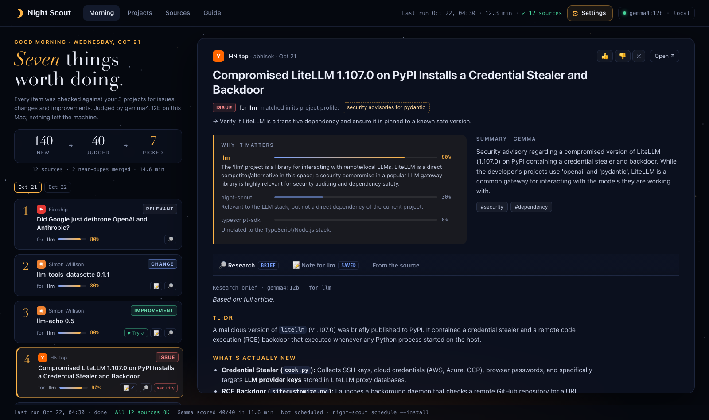

# Night Scout

**An overnight scout that turns the internet into next steps for your own projects.**

Before bed you do nothing. Overnight, Night Scout reads the feeds you'd otherwise
doom-scroll: YouTube channels, blogs, Hacker News, Reddit, Bluesky, Mastodon and GitHub
releases. A local Gemma model, running through Ollama, judges what matters **to the
projects on your disk**. In the morning you get a short list of things worth doing, each
with a typed next step: *Try it* in a sandbox, *Research more*, *Note for project*,
*Watch later*.

It's not another feed of summaries. Most mornings it should be three to seven cards long,
and some mornings it should say "nothing cleared the bar".



- **Project-aware.** It reads your READMEs and dependency files and builds a small,
  editable profile of what each project cares about.
- **Action-first.** Every pick comes with a reason ("relevant to *X* because…") and one to
  three concrete actions.
- **Local and free.** Open weights on your own machine: your project context never leaves
  the laptop, each run costs $0, and it can run every night forever.
- **Nothing runs on its own.** The nightly run only proposes. Try-it plans run in a
  throwaway sandbox, and only after you read the exact commands and confirm.

## 2-minute quick start

You need Python 3.11+ and [Ollama](https://ollama.com).

```sh
# 1. Ollama and the models (Gemma 4 12B judges, EmbeddingGemma pre-filters)
brew install --cask ollama-app      # or the installer from ollama.com
ollama pull gemma4:12b
ollama pull embeddinggemma-2:270m
ollama pull gemma4:e4b              # optional smaller fallback

# 2. Night Scout
git clone https://github.com/saixiong/nightscout && cd nightscout
python3 -m venv .venv && . .venv/bin/activate
pip install -e .

# 3. Point it at your projects, run once, open the morning view
night-scout init ~/code/project-a ~/code/project-b
night-scout run          # first run: ~10-15 min on an M-series Mac
night-scout serve        # opens http://127.0.0.1:8765

# 4. Make it nightly
night-scout schedule             # shows what will be installed
night-scout schedule --install   # launchd (macOS) / systemd timer (Linux)
```

> Use the official Ollama build (the cask or ollama.com). Homebrew's `ollama` *formula*
> currently ships without the grammar library that constrains output to a JSON schema.
> Night Scout still works on it (it falls back to schema-in-prompt plus validation), but
> constrained output is more reliable.

`night-scout init` writes `~/.night-scout/config.yaml` with a small, public-safe starter set
of sources. Edit it, or use the **Sources** page in the web UI. Set `NIGHT_SCOUT_HOME` to keep
everything somewhere else.

## How a night works

```
fetch ─► dedupe ─► pre-filter ─► Gemma judges ─► Gemma proposes ─► digest
 7 kinds  URL +     EmbeddingGemma   relevance 0–1   try_it /           digests/YYYY-MM-DD.md
 of feeds near-dup  + keywords +     per project,    research_more /    + the Morning page
          (cosine)  your 👍/👎       summary, topics note / watch_later
```

1. **Fetch** new items from official feeds and public APIs only: YouTube channel RSS (plus
   transcripts when available), RSS/Atom, Hacker News (Firebase + Algolia), Reddit
   subreddit RSS, the Bluesky public AppView, Mastodon hashtag timelines, and GitHub releases
   and repo search. Requests are spaced per host and use a descriptive User-Agent. A
   source that fails is reported ("Reddit r/x: HTTP 429, skipped") and the run goes on.
2. **Dedupe** by canonical URL (tracking parameters stripped, YouTube URL forms folded)
   and by embedding similarity. Something seen on HN *and* Reddit counts as one item with
   a little extra buzz.
3. **Pre-filter** cheaply, so Gemma only reads likely-relevant items. Each project's
   interests become retrieval queries for EmbeddingGemma, and keyword hits on your
   dependencies plus your feedback nudge the order.
4. **Judge.** Gemma returns structured JSON (validated against a schema, retried once,
   skipped and logged if still invalid): a relevance score and one-line reason per project,
   a 2–3 sentence summary and topic tags.
5. **Propose.** For items above the bar, Gemma suggests one to three typed actions. A
   Try-it plan is install commands, a smoke test and the output that means "it works".
6. **Digest.** The top picks (seven by default) go to markdown and the web UI.

## The safety model

Night Scout reads untrusted text from the internet and asks a language model to suggest
commands. It's built so that this can't hurt you by itself.

- **Nothing runs automatically.** The nightly run only writes proposals.
- **The denylist runs at proposal time and again just before a run.** It refuses sudo,
  `curl | sh` and download-then-run, global or user installs, `rm -rf` outside the
  sandbox, credential paths (`~/.ssh`, `.aws`, `.env`…), your home directory, local
  services, uploads and backgrounded processes. A refused plan shows the reasons
  instead of a Run button.
- **Explicit confirm.** Before anything runs you see the exact commands, where they'll run,
  the time limit, the pass condition and a supply-chain warning. Then you tick a box.
- **A throwaway sandbox, every time:**
  - With Docker or Podman: a fresh container with no host mounts except the read-only
    script, all capabilities dropped, `no-new-privileges`, 2 GB RAM, 2 CPUs, 512 PIDs,
    removed afterwards.
  - Otherwise: a fresh virtualenv in a temp dir with a scrubbed environment (no tokens or
    keys, `HOME` inside the sandbox), fenced by the OS:
    - On macOS, `sandbox-exec` blocks reading your home folder and other drives, writing
      outside the sandbox, talking to local services (this UI, Ollama, Docker's socket)
      and launching apps.
    - On Linux, bubblewrap gives a read-only system with an empty home.
    - Where neither fence exists, venv runs are refused unless you opt in.
  - Always a timeout that kills the whole process group, captured logs, and a pass/fail
    against the expected output. The sandbox directory is deleted afterwards.
- **Feed text is treated as data.** Every prompt tells Gemma that item text is untrusted
  and must not be followed. *Research more* only fetches public addresses (checked on
  every redirect, connecting to the checked IP). The UI renders no remote images.
- **The local web UI** binds to 127.0.0.1 only, needs a per-launch session key, checks
  Host and Origin, puts a CSRF token on every form, and sends a strict Content-Security-Policy.
- **Notes** are written only when you click, only inside that project's
  `notes/night-scout/` folder, and never overwrite a file.

Packages from the internet are a supply-chain risk. The sandbox limits the damage; it
doesn't make a package trustworthy.

## Privacy

Your profile, the database, digests and votes live in `~/.night-scout/` (or
`$NIGHT_SCOUT_HOME`). The only network traffic is the fetches to public sources (and, if you
click Research more, to that item's page). Model calls go to Ollama on localhost.

## Configuration

`config.yaml` holds the models, thresholds, sources, project directories and schedule:

```yaml
model:
  name: gemma4:12b          # judge
  fallback: gemma4:e4b      # used if the default isn't installed or fails to load
  embed: embeddinggemma-2:270m
thresholds:
  max_scored: 40            # how many pre-filtered items Gemma reads per night
  relevance: 0.6            # bar for the digest
  digest_size: 7
projects:
  - path: ~/code/project-a
sources:
  youtube: [{name: Fireship, channel_id: UCsBjURrPoezykLs9EqgamOA}]
  rss: [{name: Simon Willison, url: https://simonwillison.net/atom/everything/}]
  hackernews: {lists: [top, show], keywords: [ollama, gemma]}
  reddit: {subreddits: [LocalLLaMA]}
  bluesky: {queries: [local llm], actors: [], feeds: []}
  mastodon: [{instance: mastodon.social, hashtags: [llm]}]
  github: {releases: [ollama/ollama], search: ["topic:llm language:python"]}
schedule:
  time: "04:30"
```

`profile.yaml` is yours to edit. `night-scout profile` regenerates it from your projects
(and overwrites your edits).

## How it compares

There's good prior art in open-source news aggregation:
[AI News Brief](https://github.com/frankzch/ai-news-brief),
[Auto-News](https://github.com/finaldie/auto-news) and
[news-agent](https://github.com/huawolf/news-agent). They collect, summarize and rank.
Night Scout differs in two ways:

- **It knows your projects.** Relevance is judged per project, from your actual READMEs and
  dependencies, not a list of keywords.
- **It ends in an action.** Each pick is a typed next step you can take in a click: a
  sandboxed trial, a research brief, or a note in the repo.

## Development

```sh
pip install -e '.[dev]'
pytest            # fixture feeds for every source, a fake Ollama, the denylist, the sandbox
ruff check . && mypy night_scout
```

The core is importable (`night_scout.core`); the CLI and web UI are thin layers over it.

Built with [Gemma](https://ai.google.dev/gemma) via [Ollama](https://ollama.com),
FastAPI, feedparser, httpx, pydantic and youtube-transcript-api.

## License

MIT. See [LICENSE](LICENSE).
